# Discover pipeline decorators in Azure DevOps

Pipeline decorators are little-known in Azure DevOps, but immensely powerful. I have helped companies adopt a DevOps culture in their development processes for more than ten years. One concern I have observed is how to implement governance. Stakeholders want to give development teams greater freedom while ensuring an appropriate level of quality and security during development.
Pipeline decorators offer a solution. They allow you to inject steps at the beginning and end of every job in any workflow in your organization. This happens automatically, without requiring the workflow owners' consent or intervention. This article will demystify how they work.

This subject will be split into five parts:

- Part 1: Discover pipeline decorators and create your first decorator
- Part 2: Deploy your decorator, validate it, and enhance it
- Part 3: Create a more advanced decorator: a Docker linter
- Part 4: Create another advanced decorator: a credential scanner
- Part 5: Tips and tricks

> Find the latest version of [the guide and the source code for all decorators here](https://github.com/lgmorand/azure-devops-pipeline-decorators).

## Part 1: Our first decorator

### What are pipeline decorators?

Pipeline decorators allow [custom tasks](https://learn.microsoft.com/en-us/azure/devops/extend/develop/add-build-task) (build or release) to be injected automatically into all workflows in an Azure DevOps organization without requiring the pipeline creators' consent. In a perfect world, each development team is responsible for building its pipelines and ensuring they follow the company's shared best practices. To help, another team (often the one managing the Azure DevOps organization) may create custom tasks and make them available to users to enrich their pipelines. A task could be a wrapper for a complex build process or a tool such as an SCA or SAST analyzer.

The issue with this approach is that you can't ensure that users will add the required tasks to their pipelines, and they could easily bypass the quality processes you are trying to establish during the development lifecycle. That's where pipeline decorators come in.

### Requirements

To follow this guide and create and deploy pipeline decorators, you will need:

- An Azure DevOps organization where you are an administrator (you can [create one for free](https://learn.microsoft.com/en-us/azure/devops/organizations/accounts/create-organization))
- A publisher account on the Azure DevOps Marketplace
- [TFX CLI](https://www.npmjs.com/package/tfx-cli), which requires [Node.js](https://nodejs.org) to be installed on your machine
- (Optional) [Visual Studio Code Extension Manager](https://github.com/microsoft/vscode-vsce) (VSCE)

### Create our first decorator

We are going to start with a simple example. In this "hello world" example, we will inject a simple task into all workflows in our organization to understand how to build and deploy a pipeline decorator. Later, we will explore how to customize these decorators and create more complex ones.

Create a folder named banner-decorator and add two files: *vss-extension.json* and *banner-decorator.yml*. The structure should look like this:

```bash
| banner-decorator
| -- vss-extension.json
| -- banner-decorator.yml
```

We need to declare the actions our decorator will perform in *banner-decorator.yml*. The format is the same as for YAML pipelines, where you can add different steps. In our first decorator, we will add only one step to display a message in the pipeline logs.

```yaml
steps:
  - task: CmdLine@2
    displayName: '(Injected) Here is my super banner'
    inputs:
      script: |
        echo "This step is automatically injected into your workflow as part of the company's governance policy."
        
        echo "_______  _        _        _______ "
        echo "|\     /|(  ____ \( \      ( \      (  ___  )"
        echo "| )   ( || (    \/| (      | (      | (   ) |"
        echo "| (___) || (__    | |      | |      | |   | |"
        echo "|  ___  ||  __)   | |      | |      | |   | |"
        echo "| (   ) || (      | |      | |      | |   | |"
        echo "| )   ( || (____/\| (____/\| (____/\| (___) |"
        echo "|/     \|(_______/(_______/(_______/(_______)"
        echo " "
        echo " _______                    _______  _ "
        echo "(  ____ \|\     /||\     /|(  ____ \( )"
        echo "| (    \/| )   ( |( \   / )| (    \/| |"
        echo "| |      | |   | | \ (_) / | (_____ | |"
        echo "| | ____ | |   | |  \   /  (_____  )| |"
        echo "| | \_  )| |   | |   ) (         ) |(_)"
        echo "| (___) || (___) |   | |   /\____) | _ "
        echo "(_______)(_______)   \_/   \_______)(_)"
```

We now need to create a manifest to describe our extension, specify its type (decorator), and define the conditions for injecting it. The following fields describe the contribution:

- **id**: An ID to name your decorator
- **type**: Specifies that this contribution is a pipeline decorator. Must be the string **ms.azure-pipelines.pipeline-decorator**
- **targets**: Decorators can run before a job or specified task, after it, or both. See the table below for available options
- **properties.template**: The YAML template that defines the steps for your pipeline decorator. Its path is relative to the root of your extension folder
- **properties.targettask** (optional): The target task ID used for ms.azure-pipelines-agent-job.pre-task-tasks or ms.azure-pipelines-agent-job.post-task-tasks targets. Must be a GUID string such as 89b8ac58-8cb7-4479-a362-1baaacc6c7ad

The question we have to ask ourselves is, "Where do we want to inject our decorator?" At the beginning or end of a job? In a release pipeline or only in a build pipeline?

| Target | Description |
|---|---|
|ms.azure-pipelines-agent-job.pre-job-tasks|Run before other tasks in a classic build or YAML pipeline. Due to differences in how source code checkout happens, this target runs after checkout in a YAML pipeline but before checkout in a classic build pipeline.|
|ms.azure-pipelines-agent-job.post-checkout-tasks|Run after the last checkout task in a classic build or YAML pipeline.|
|ms.azure-pipelines-agent-job.post-job-tasks|Run after other tasks in a classic build or YAML pipeline.|
|ms.azure-pipelines-agent-job.pre-task-tasks|Run before the specified task in a classic build or YAML pipeline.|
|ms.azure-pipelines-agent-job.post-task-tasks|Run after the specified task in a classic build or YAML pipeline.|
|ms.azure-release-pipelines-agent-job.pre-task-tasks|Run before the specified task in a classic RM pipeline.|
|ms.azure-release-pipelines-agent-job.post-task-tasks|Run after the specified task in a classic RM pipeline.|
|ms.azure-release-pipelines-agent-job.pre-job-tasks|Run before other tasks in a classic RM pipeline.|

In our case, we want to display the banner at the beginning of any workflow and we need to reference our YAML file (banner-decorator.yml):

```json
"contributions": [
        {
            "id": "my-required-task",
            "type": "ms.azure-pipelines.pipeline-decorator",
            "targets": [
                "ms.azure-pipelines-agent-job.pre-job-tasks"
            ],
            "properties": {
                "template": "banner-decorator.yml"
            }
        }
    ],
```

The last part is related to the files that should be included during the packaging process:

```json
"files": [
        {
            "path": "banner-decorator.yml",
            "addressable": true,
            "contentType": "text/plain"
        }
    ]
```

The final version of your *vss-extension.json* file should look like this:

```json
{
    "manifestVersion": 1,
    "id": "bannerdecorator-by-lgmorand",
    "name": "A simple banner decorator",
    "version": "1.0.0",
    "publisher": "lgmorand",
    "targets": [
        {
            "id": "Microsoft.VisualStudio.Services"
        }
    ],    
    "description": "A simple banner decorator that displays a message.",
    "categories": [
        "Azure Pipelines"
    ],
    "contributions": [
        {
            "id": "my-injected-banner",
            "type": "ms.azure-pipelines.pipeline-decorator",
            "targets": [
                "ms.azure-pipelines-agent-job.pre-job-tasks"
            ],
            "properties": {
                "template": "banner-decorator.yml"
            }
        }
    ],
    "files": [
        {
            "path": "banner-decorator.yml",
            "addressable": true,
            "contentType": "text/plain"
        }
    ]
}
```

We now need to package it as an Azure DevOps extension because that is how it is published. There are several types of extensions, including build tasks, web extensions that enrich the UI, and pipeline decorators. To create our extension, we need to use [TFX CLI](https://www.npmjs.com/package/tfx-cli). Start by installing it on your system:

```bash
npm install -g tfx-cli
```

Then, open a terminal and ensure that you are in the root folder of your pipeline decorator. From there, you can use the *extension create* command:

```bash
tfx extension create
```

You should obtain a new file with the .vsix extension, based on the information in *vss-extension.json*.

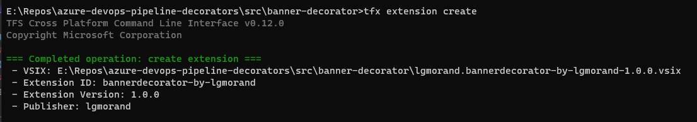

Our pipeline decorator is ready. It's now time to publish it and make it available to our organization. This will be covered in the second part of this article.

## Part 2: Deploy your decorator, validate it, and enhance it

### Create a publisher account

Since Azure DevOps Services is a SaaS offering, extensions used to customize your organization must come from the [Azure DevOps Marketplace](https://marketplace.visualstudio.com/azuredevops). In our case, we need to publish our pipeline decorator as an extension on this marketplace. To do so, we need a publisher account, even though, as we'll see later, only our organization will be able to see and install our extension.

> A publisher account is only required if you plan to install your extension in Azure DevOps Services (the SaaS version). On Azure DevOps Server (on-premises), the standalone VSIX file is sufficient.

To do this, go to the [management portal](https://marketplace.visualstudio.com/manage), which should prompt you to create a publisher account. The user account you use matters, as it will also need to have administrator permissions in your Azure DevOps organization.

> When creating my publisher account, I discovered that my ID was already in use. I had created the existing publisher using another account when I was younger. I tried to delete it without success until I found a solution, which I [documented here](https://lgmorand.github.io/blog/delete-publisher).

### Upload your extension

It's now time to upload our extension to the marketplace. To do this, you need:

- The generated extension (*.vsix)
- A manifest (vss-extension.json) whose *publisher* value exactly matches the ID of the publisher account you just created


Once the extension is uploaded and validated, you can check the result by opening the context menu (...) and choosing "*View extension*" to see your extension's page. This is what a user would see if your extension were public:

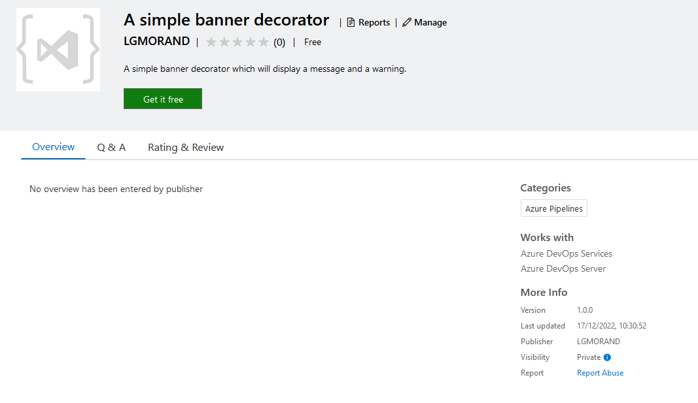

We still need to make it available to our organization. To do so, click on "*Share/Unshare*" in the context menu to open a side panel where you can enter the names of the organizations you want to share your extension with:

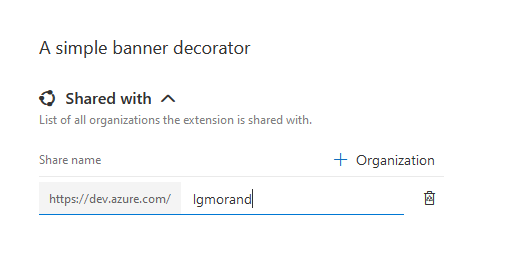

Now, go back to your Azure DevOps organization. Open the *Organization settings* screen and then the *Extensions* tab. This screen shows **Installed** extensions, **Requested** extensions (those requested by users without sufficient permissions to install them), and **Shared** extensions. You should now see your custom decorator in the last category.

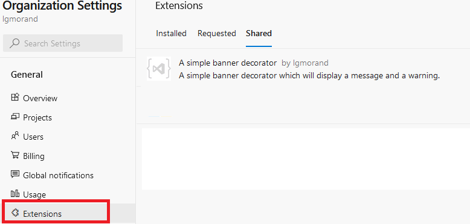

This means that the extension is available, but it is not installed yet. Click on the extension and select "*Install*" to install it in your organization.

### Time to check that the decorator is working

This part is the easiest one. We added no specific conditions to our manifest except that it should run for any pipeline (classic or YAML) by using the property *ms.azure-pipelines-agent-job.pre-job-tasks*.

Run any of your pipelines and check the result.

### Enhance our decorator

A decorator is injected implicitly into pipeline runs. Users may be surprised to see something added to their pipeline without knowing where it comes from. We are going to improve the experience in several ways:

- Add an icon to brand your decorator
- Add a README-style overview that provides information about your decorator
- Add a hint to the step title
- Add a log message

First, we need to help users understand that the injected steps were added deliberately, not by accident or by the users themselves. I like to add "(Injected)" to the step titles as a hint.

```yaml
steps:
  - task: CmdLine@2
    displayName: '(Injected) Here is my super banner'
```

You can also add a simple log message to your decorator's YAML file.

```bash
echo "This step is automatically injected into your workflow as part of the company's governance policy."
```

A second quick win is to add an icon to your extension to make it more recognizable. In your decorator's folder, add a folder named "images" and place a PNG image inside it (the size should be 128 x 128 pixels). Then reference this icon in *vss-extension.json* by adding:

```json
"icons": {
        "default": "images/extension-icon.png"        
},
```

You can also add an overview to describe your decorator.

If you repackage your decorator and try to upload it to the portal without changing its version, you will get an error message:

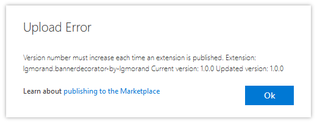

It means that you must increment the version inside the manifest (vss-extension.json).

Take a few seconds to increment the *version* property. Your final file should look something like this (the YAML file banner-decorator.yml remains unchanged):

```json
{
    "manifestVersion": 1,
    "id": "bannerdecorator-by-lgmorand",
    "name": "A simple banner decorator",
    "version": "1.0.1",
    "publisher": "lgmorand",
    "targets": [
        {
            "id": "Microsoft.VisualStudio.Services"
        }
    ],    
    "description": "A simple banner decorator that displays a message and a warning.",
    "categories": [
        "Azure Pipelines"
    ],
    "icons": {
        "default": "images/extension-icon.png"        
    },
    "contributions": [
        {
            "id": "my-injected-banner",
            "type": "ms.azure-pipelines.pipeline-decorator",
            "targets": [
                "ms.azure-pipelines-agent-job.pre-job-tasks"
            ],
            "properties": {
                "template": "banner-decorator.yml"
            }
        }
    ],
    "files": [
        {
            "path": "banner-decorator.yml",
            "addressable": true,
            "contentType": "text/plain"
        }
    ]
}
```

You can also use the --rev-version parameter, which will increment the version for you during packaging:

```bash
tfx extension create --rev-version
```

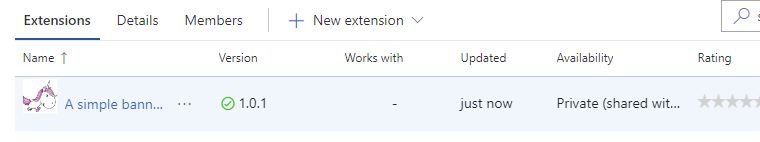

If you go back to your organization, you will notice that the extension has been automatically updated to the latest version; you don't need to reinstall it.

We can now enhance our decorator to output a second message at the end of the workflow without creating a second decorator. To do this, add another *contribution* with a *post-job* target and optionally use a different YAML file. The contributions would look like this:

```json
"contributions": [
        {
            "id": "my-injected-banner",
            "type": "ms.azure-pipelines.pipeline-decorator",
            "targets": [
                "ms.azure-pipelines-agent-job.pre-job-tasks"
            ],
            "properties": {
                "template": "banner-decorator.yml"
            }
        },
        {
            "id": "my-second-injected-banner",
            "type": "ms.azure-pipelines.pipeline-decorator",
            "targets": [
                "ms.azure-pipelines-agent-job.post-job-tasks"
            ],
            "properties": {
                "template": "byebye.yml"
            }
        }
    ]
```

And the result, once injected into a workflow, should look like this:

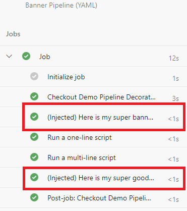

> *Source code:* [Download the source code for this decorator here](https://github.com/lgmorand/azure-devops-pipeline-decorators/tree/main/src/banner-decorator).

## Part 3: Create a Docker linter

For this second decorator, we would like to build a task that analyzes a Dockerfile and checks that it follows best practices. There are plenty of tools to do this, such as [dockle](https://github.com/goodwithtech/dockle) and [hadolint](https://github.com/hadolint/hadolint). In our case, we chose [dockerfilelint](https://github.com/replicatedhq/dockerfilelint) for its simplicity.

### Build our linter task

Technically, we need to create a task that:

- Checks whether a Dockerfile exists in the source code
- Installs dockerfilelint if a Dockerfile is found
- Scans each Dockerfile and reports the results
- Stops the workflow if issues are found

The script in our decorator could look like this:

```yml
steps:
  - task: CmdLine@2
    displayName: '(Injected) Docker linter'
    inputs:
      script: |
        
        echo 'Looking for Dockerfiles'
        filePath=$(find -type f -name Dockerfile)
        if [ -z "$filePath" ]
        then
              echo "No Dockerfile was found"
        else
              echo "Dockerfile(s) found: $filePath"

              echo 'Installing dockerfilelint'
              npm install -g dockerfilelint --silent
              echo 'Installed version: '
              dockerfilelint -v
              
              echo 'Running dockerfilelint'
              find -type f -name 'Dockerfile' -exec dockerfilelint {} \;
              # Explanation of find+exec: https://stackoverflow.com/questions/9612090/how-to-loop-through-file-names-returned-by-find

              if echo "$result" | grep -q "None found"; then
                  echo "No issues found"
              else
                  echo "Issues found"
                  exit 1 # Return an error to stop the workflow
              fi
        fi
```

Once the YAML file is ready, we just need to create the vss-extension.json file:

```json
{
    "manifestVersion": 1,
    "id": "dockerlinter-by-lgmorand",
    "name": "A Docker linter decorator",
    "version": "1.0.0",
    "publisher": "lgmorand",
    "targets": [
        {
            "id": "Microsoft.VisualStudio.Services"
        }
    ],    
    "description": "A Docker linter based on dockerfilelint.",
    "categories": [
        "Azure Pipelines"
    ],
    "icons": {
        "default": "images/extension-icon.png"        
    },
    "content": {
        "details": {
            "path": "overview.md"
        }
    },
    "contributions": [
        {
            "id": "docker-linter-decorator",
            "type": "ms.azure-pipelines.pipeline-decorator",
            "targets": [
                "ms.azure-pipelines-agent-job.pre-job-tasks"
            ],
            "properties": {
                "template": "docker-linter-decorator.yml",
            }
        }
    ],
    "files": [
        {
            "path": "docker-linter-decorator.yml",
            "addressable": true,
            "contentType": "text/plain"
        }
    ]
}
```

We can now package it, publish it and deploy it to our organization.

### My decorator is injected too often

When we test it, our decorator works as expected, but it is also injected into all workflows in our organization, including those that don't use Docker. This could be an issue, as it increases the duration of each pipeline run (especially if the source code contains many files). If you have several decorators in your organization, each pipeline could become cluttered with irrelevant steps.

We need to find a way to target only pipelines that use Dockerfiles. We could restrict the decorator to specific projects by adding a condition, but that would require hard-coding each project's GUID, like this (there are [other ways to filter by project](#part-5-tips-and-tricks)):

```yaml
steps:
- ${{ if eq(resources.repositories['self'].project, '123455-2492-6524-9851-564526e8fc8') }}
```

Another approach is to check for the presence of specific tasks in the pipelines. In our case, we want to analyze each Dockerfile with *dockerfilelint* before using it to build a Docker image. The simplest way to do this is to target pipelines that contain the built-in Docker task:

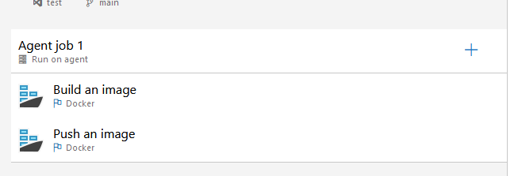

In our case, the ID of the Docker task is: "e28912f1-0114-4464-802a-a3a35437fd16"

> To find a built-in task's ID, check [this repository](https://github.com/microsoft/azure-pipelines-tasks/tree/master/Tasks) and open its task.json file. For a custom task from the marketplace, download its VSIX file and unzip it to find task.json. To obtain the VSIX file, go to the marketplace and try to install the extension. Instead of installing it in your organization, choose the Azure DevOps Server option and download the file:
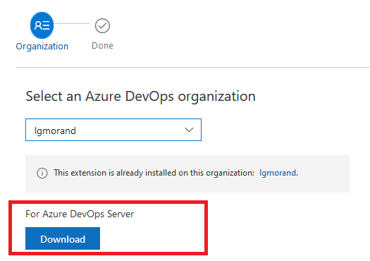

Once we have the task's ID, we need to change our decorator's target to inject it before each occurrence of that task. We can do this using the **ms.azure-pipelines-agent-job.pre-task-tasks** target and adding the *targettask* property with the task's GUID.

The contributions in our final vss-extension.json file look like this:

```json
"contributions": [
    {
        "id": "docker-linter-decorator",
        "type": "ms.azure-pipelines.pipeline-decorator",
        "targets": [
            "ms.azure-pipelines-agent-job.pre-task-tasks"
        ],
        "properties": {
            "template": "docker-linter-decorator.yml",
            "targettask": "e28912f1-0114-4464-802a-a3a35437fd16"
        }
    }
],
```

> Note: If users run the *docker* command directly within a script or a CmdLine task, our decorator will not be injected, as we can't parse the pipeline file to detect a keyword. I'm not aware of a solution for this use case.

Let's package a new version of our decorator and deploy it. If we run a workflow that uses the Docker task, our decorator is injected, as shown in [this example](https://dev.azure.com/lgmorand/Demo%20Pipeline%20Decorators/_build/results?buildId=3181&view=logs&j=275f1d19-1bd8-5591-b06b-07d489ea915a):

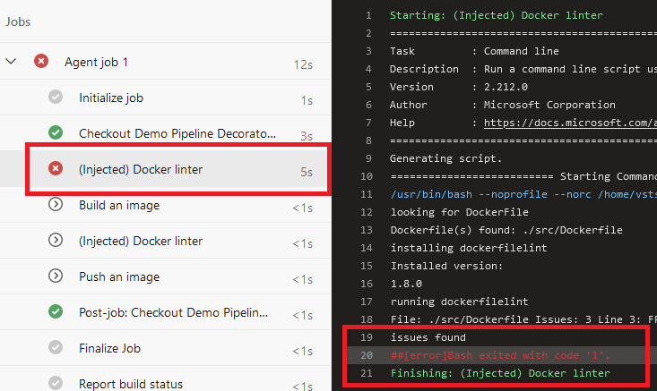

It's not perfect, but it does the job. Injecting a decorator before specific tasks is very useful for targeting relevant workflows.

## Part 4: Create a smart credential scanner

For this last decorator, we are going to inject another security tool into the pipeline, but only if the tool is not already present in the workflow. We will also need to do more than inject command-line scripts.

> Important: This extension is private and not listed on the public Azure DevOps Marketplace, so you won't find it there. Nevertheless, I chose it because it perfectly illustrates what I want to demonstrate.

### Specify what we want to scan and how

This extension contains a dozen security tools, and each pipeline may require different tasks depending on what you want to scan or achieve. In my case, I need:

- A task to scan files for credentials
- A task to convert the results into a standard SARIF file
- A task to upload the SARIF file as an artifact
- A task to stop the workflow if credentials are found

In a classic workflow, it looks like this:

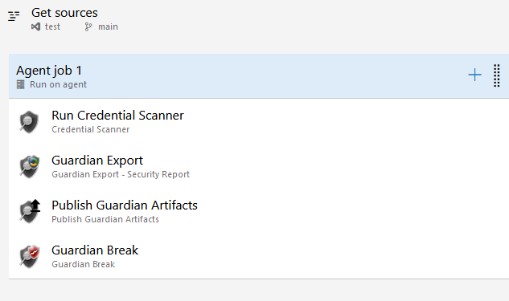

We want to create a decorator that injects the same four tasks, but we need to get their internal names first. To get a task's name, add it to a test YAML pipeline or a test classic pipeline. In a classic pipeline, click the "View YAML" button once the task is configured. The generated YAML contains exactly what you need to put in your decorator.

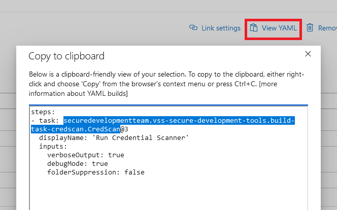

Once we have the name of each task, we can build our decorator's YAML file, which will inject these four tasks whenever the "Run Credential Scanner" task is **not** found:

```yaml
steps:
- ${{ if not(containsValue(job.steps.*.task.id, 'ea576cd4-c61f-48f8-97e7-a3cb07b90a6f')) }}:
  - task: securedevelopmentteam.vss-secure-development-tools.build-task-credscan.CredScan@3
    displayName: 'Run CredScan (Injected)'
    inputs:
      debugMode: false
  - task: securedevelopmentteam.vss-secure-development-tools.build-task-report.SdtReport@2
    displayName: 'Create Security Analysis Report (Injected)'
    inputs:
      CredScan: true
  - task: securedevelopmentteam.vss-secure-development-tools.build-task-publishsecurityanalysislogs.PublishSecurityAnalysisLogs@3
    displayName: 'Publish Security Analysis Logs (Injected)'
    inputs:
      AllTools: false
      CredScan: true
  - task: securedevelopmentteam.vss-secure-development-tools.build-task-postanalysis.PostAnalysis@2
    displayName: 'Post Analysis (Injected)'
    inputs:
      CredScan: true
```

Finally, we need to create the vss-extension.json file:

```json
"contributions": [
        {
            "id": "credscan-decorator",
            "type": "ms.azure-pipelines.pipeline-decorator",
            "targets": [
                "ms.azure-pipelines-agent-job.pre-job-tasks"
            ],
            "properties": {
                "template": "credscan-decorator.yml"
            }
        }
    ],
    "files": [
        {
            "path": "credscan-decorator.yml",
            "addressable": true,
            "contentType": "text/plain"
        }
    ]
```

### Make it compatible with all types of workflows

Unfortunately, this version of our decorator only works for YAML pipelines. As explained in the documentation, injection in a classic pipeline occurs before the checkout task. Since the source code is not yet available, the scan cannot return any results. To support both types of pipelines, change the target to **ms.azure-pipelines-agent-job.post-checkout-tasks** so that injection occurs after checkout.

The final **vss-extension.json** file would look like this:

```json
{
    "manifestVersion": 1,
    "id": "credscandecorator-by-lgmorand",
    "name": "A credential scanner decorator",
    "version": "1.0.0",
    "publisher": "lgmorand",
    "targets": [
        {
            "id": "Microsoft.VisualStudio.Services"
        }
    ],    
    "description": "A credential scanner.",
    "categories": [
        "Azure Pipelines"
    ],
    "icons": {
        "default": "images/extension-icon.png"        
    },
    "contributions": [
        {
            "id": "credscan-decorator",
            "type": "ms.azure-pipelines.pipeline-decorator",
            "targets": [
                "ms.azure-pipelines-agent-job.post-checkout-tasks"
            ],
            "properties": {
                "template": "credscan-decorator.yml"
            }
        }
    ],
    "files": [
        {
            "path": "credscan-decorator.yml",
            "addressable": true,
            "contentType": "text/plain"
        }
    ]
}
```

Once the decorator is packaged, uploaded to the marketplace, and installed in your organization, run a workflow to test it:

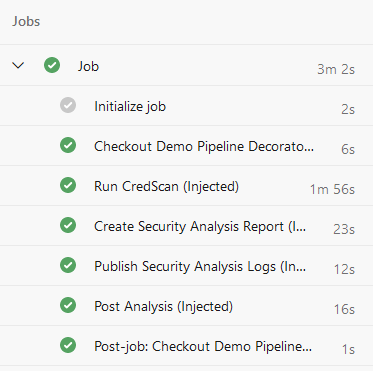

## Part 5: Tips and tricks

Since we could not cover every capability with concrete decorator examples, here are some additional tips.

### Only inject the decorator for a specific project

You may want to inject a decorator into specific projects or, conversely, exclude it from specific projects. There are several ways to do so:

```yaml
steps:
- ${{ if eq(resources.repositories['self'].project, '09bbdc2c-51d3-4b05-b97a-0acdc1817cc7') }}:
  - task: anytask
```

For a classic workflow, the name of the current repository is different, so the reference should use *__designer_repo*:

```yaml
steps:
- ${{ if eq(resources.repositories['__designer_repo'].project,'09bbdc2c-51d3-4b05-b97a-0acdc1817cc7') }}:
  - task: anytask
```

Alternatively, use the *System.TeamProject* or *System.TeamProjectId* variables:

```yaml
steps:
- ${{ if eq(variables['System.TeamProject'], 'ProjectA')  }}:
  - task: anytask
```

If you want to inject the decorator into all projects except a specific one, invert the condition:

```yaml
steps:
- ${{ if not(eq(variables['System.TeamProject'], 'ProjectA'))  }}:
  - task: anytask
```

### Do not inject the decorator if a specific variable is present

The following example shows how to avoid injecting the decorator if the variable is present and its value is *true*:

```yaml
steps:
- ${{ if ne(variables['skipDecoratorInjection'], 'true')) }}:
  - task: anytask
```

### Do not inject the decorator if a specific task is already present

See Part 4 of this guide for the credential scanner example.

```yaml
steps:
- ${{ if containsValue(job.steps.*.task.id, 'EA576CD4-C61F-48F8-97E7-A3CB07B90A6F') }}::
  - task: anytask
```

### Inject depending on the operating system

This case is a little different: the condition cannot be evaluated at the job (top) level because decorators are parsed before an agent is assigned to the run. The check must be performed at the task level:

```yaml
- task: CmdLine@2
  displayName: '(Injected) Task test: OS is Windows'
  condition: eq(variables['Agent.OS'], 'Windows_NT')
  inputs:
    script: |
        echo %AGENT_OS% 

- task: CmdLine@2
  displayName: '(Injected) Task test: OS is Linux'
  condition: eq(variables['Agent.OS'], 'Linux')
  inputs:
    script: |
        echo $AGENT_OS 
```

And the result:

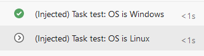

> The syntax for accessing environment variables depends on the operating system. Also, Agent.OS becomes AGENT_OS when accessed as an environment variable in a script, [as explained in the documentation](https://learn.microsoft.com/en-us/azure/devops/pipelines/process/variables?view=azure-devops&tabs=yaml%2Cbatch#environment-variables). This can be tricky.

### Mix conditions

Of course, you can create complex conditions using expressions ([see documentation](https://learn.microsoft.com/en-us/azure/devops/pipelines/process/expressions?WT.mc_id=DOP-MVP-5001511&view=azure-devops)):

```yaml
steps:
- ${{ if or(containsValue(job.steps.*.task.id, 'EA576CD4-C61F-48F8-97E7-A3CB07B90A6F'), variables['skipDecoratorInjection'], 'true')) }}::
  - task: anytask
```

## Conclusion

1. Pipeline decorators apply across the entire Azure DevOps organization. Consider their implications for all pipelines in the organization and their potential impact on existing pipelines.
2. Conditional injection is the tricky part of selecting the workflows where your decorator should apply. You may need different techniques to narrow the scope to the relevant pipelines.
3. Start with an explicit, narrow scope (targeting specific projects, for instance). Once you are confident, expand the scope, repackage, and redeploy.
4. When several decorators apply to the same workflow, their order cannot be guaranteed!
5. Targeting a specific task (such as the Docker task) can inject the same decorator several times in the same workflow, even if the decorator is non-blocking.
6. Communicate with end users when you deploy a new decorator, as they may be surprised to see new tasks in their pipelines.

I hope this guide helps you harness the power of pipeline decorators.

> If you have any feedback or suggestions for improvement, don't hesitate to contact me by opening an issue in [the repository](https://github.com/lgmorand/azure-devops-pipeline-decorators).

## Useful links

- Develop a pipeline decorator: [https://learn.microsoft.com/en-us/azure/devops/extend/develop/add-pipeline-decorator](https://learn.microsoft.com/en-us/azure/devops/extend/develop/add-pipeline-decorator)
- All the source code for this white paper: [https://github.com/lgmorand/azure-devops-pipeline-decorators](https://github.com/lgmorand/azure-devops-pipeline-decorators)
- All the runs using these decorators: [https://dev.azure.com/lgmorand/Demo%20Pipeline%20Decorators/](https://dev.azure.com/lgmorand/Demo%20Pipeline%20Decorators/)
- Azure DevOps Marketplace: [https://marketplace.visualstudio.com/azuredevops](https://marketplace.visualstudio.com/azuredevops)
- Pipeline decorator expression context: [https://learn.microsoft.com/en-us/azure/devops/extend/develop/pipeline-decorator-context](https://learn.microsoft.com/en-us/azure/devops/extend/develop/pipeline-decorator-context)
- Built-in Azure DevOps tasks (to find their IDs in task.json): [https://github.com/microsoft/azure-pipelines-tasks](https://github.com/microsoft/azure-pipelines-tasks)
- Examples of real decorators: [https://github.com/n3wt0n/AzurePipelinesDecoratorSamples/tree/master/Advanced](https://github.com/n3wt0n/AzurePipelinesDecoratorSamples/tree/master/Advanced)
- Deleting a publisher account: [https://lgmorand.github.io/blog/delete-publisher](https://lgmorand.github.io/blog/delete-publisher)

## Acknowledgments

Thank you to Clémence Lesné, Adrian Mihailescu, Romain Zert, and Fethi Dilmi for proofreading this document.
